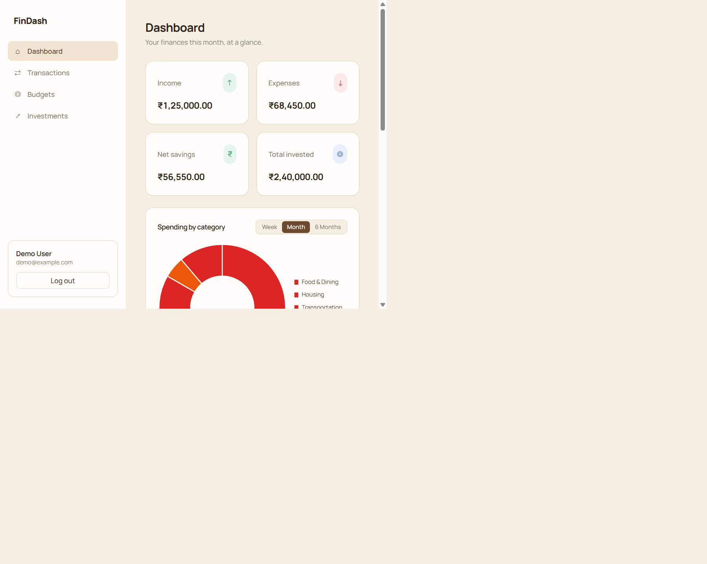
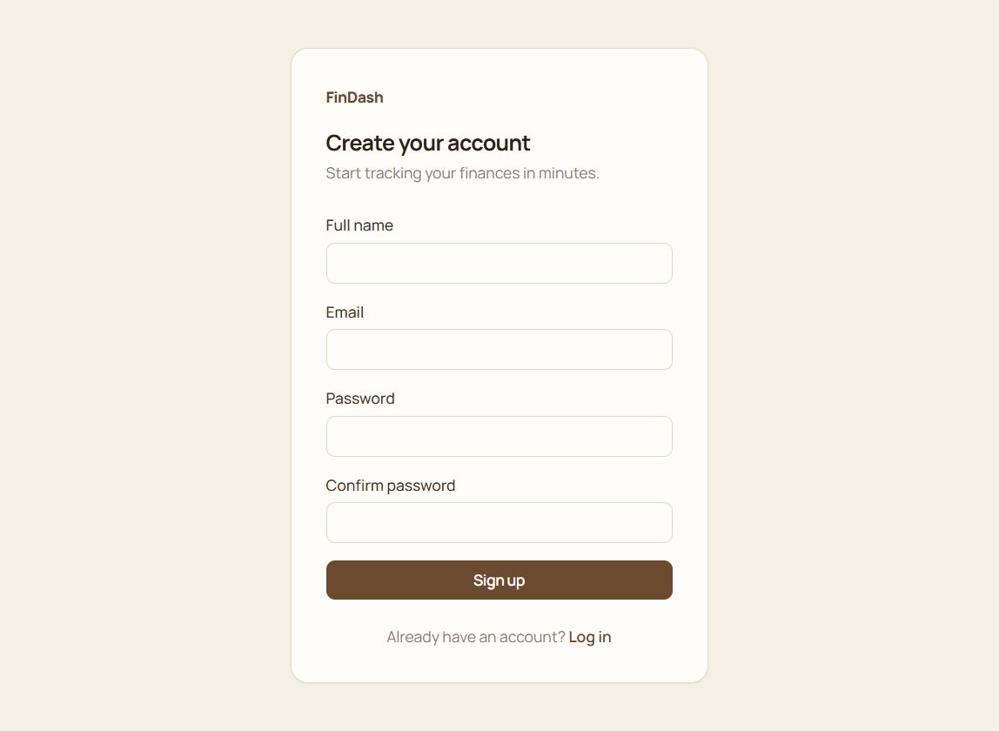

# Personal Finance Dashboard

Full-stack budgeting app: React + Tailwind CSS frontend, Node/Express REST API backed by MySQL,
and a Python ML microservice that auto-categorizes expenses from their description.

## Stack

| Layer     | Tech                                              |
|-----------|----------------------------------------------------|
| Frontend  | React (Vite), Tailwind CSS, Chart.js, React Router |
| Backend   | Node.js, Express, MySQL (mysql2), JWT auth          |
| ML        | Python, Flask, scikit-learn (TF-IDF + Naive Bayes)  |

## Screenshots

The dashboard preview uses temporary sample API responses and a demo account; the figures
are illustrative, not live account data. The login and registration images show the rendered
forms only. A MySQL server was unavailable during capture, so database-backed flows were
not exercised.

### Dashboard preview



### Login


### Registration



## Project structure

```
.
├── backend/
│   ├── db/                 MySQL schema and seed data
│   └── src/
│       ├── config/         Database configuration
│       ├── controllers/    API request handlers
│       ├── middleware/     Authentication and error handling
│       ├── routes/         REST API routes
│       └── utils/          Database seeding and ML client
├── frontend/
│   └── src/
│       ├── api/            API client
│       ├── charts/         Dashboard charts
│       ├── components/     Shared UI components
│       ├── context/        Authentication state
│       ├── pages/          Dashboard and feature pages
│       └── utils/          Formatting helpers
├── ml-service/
│   ├── data/               Category-classifier training data
│   └── model/              Generated model (not tracked)
├── screenshots/             README screenshots
├── .gitignore
└── README.md
```

## Setup

### 1. Database and backend

```bash
cd backend
cp .env.example .env
npm install
npm run seed
npm run dev
```

The seed command creates the `finance_dashboard` database, tables, and default categories.
Update `backend/.env` with your MySQL connection settings and a secure `JWT_SECRET` before
running the app.

### 2. ML microservice

```bash
cd ml-service
python -m venv .venv
.venv\Scripts\activate    # Windows PowerShell: .venv\Scripts\Activate.ps1
pip install -r requirements.txt
python train_model.py     # trains and saves model/category_classifier.joblib
python app.py              # serves http://localhost:8000
```

Run the backend and ML service in separate terminals.

### 3. Frontend

```bash
cd frontend
cp .env.example .env
npm install
npm run dev                 # serves http://localhost:5173
```

Open http://localhost:5173, sign up for an account, and start adding transactions.
Leave the category blank on an expense to see the ML service auto-suggest one.

Local environment files, dependencies, build output, generated model files, and
Claude Code settings are excluded by `.gitignore`.

## How the pieces fit together

- **Auth**: JWT issued on register/login, sent as `Authorization: Bearer <token>` on every API call.
  Already-authenticated users are redirected away from `/login` and `/register`.
- **Transactions**: `POST /api/transactions` — if no `categoryId` is given for an expense, the backend
  (`backend/src/utils/mlClient.js`) calls the ML service's `/predict-category` endpoint and uses its
  suggestion when confidence is high enough. Edits (`PUT /api/transactions/:id`) clear the auto-categorized
  flag. `GET /api/transactions/export` streams the full history as CSV.
- **Analytics**: `/api/analytics/summary`, `/spending-by-category`, `/trend` power the dashboard's stat
  cards and Chart.js visualizations. `spending-by-category` and `trend` both take `?period=week|month|6months`
  — `trend` groups by day for week/month and by month for 6months, zero-filling any bucket with no
  transactions so the chart's x-axis is always continuous.
- **Budgets**: monthly limits per category; progress is computed by joining budgets against that month's
  transactions in a single aggregate query (`backend/src/controllers/budgetController.js`).
- **Investments**: a separate `investments` table tracks money moving *into* investments (SIPs, deposits) —
  distinct from the "Investments" transaction category, which is for returns/payouts coming back *out*.
  `GET /api/investments` returns the contribution history plus a running total.
- **Color scheme**: deliberately semantic rather than categorical — green for income, blue for investment
  contributions, red for every expense category, orange singled out for Subscriptions. Colors live on
  `categories.color` in the DB (seeded in `backend/db/seed.sql`) and flow through to badges, budget bars,
  and both charts automatically.

## Performance notes

- `transactions` has composite indexes on `(user_id, txn_date)` and `(user_id, category_id, txn_date)` —
  the two access patterns the dashboard and transaction list actually use — to keep list/aggregate queries
  fast as row counts grow.
- API responses are paginated (transactions) and gzip-compressed; a per-IP rate limiter caps abusive traffic
  while leaving headroom well above 10,000 requests/day of normal use.
